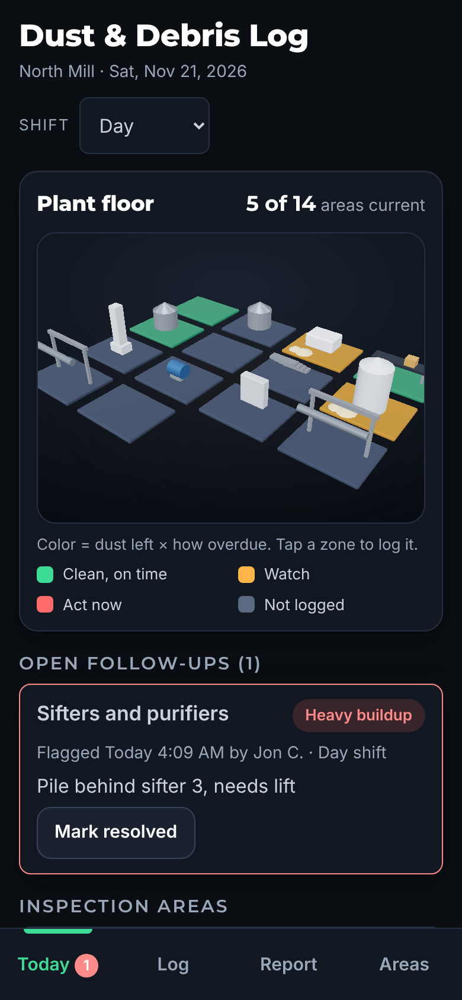
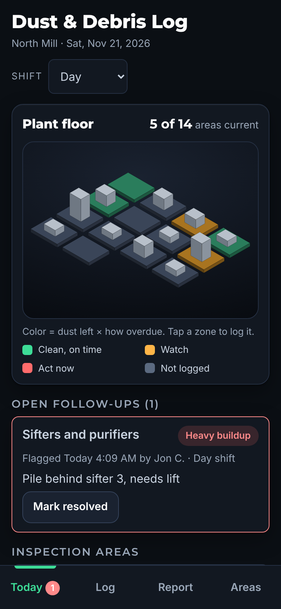
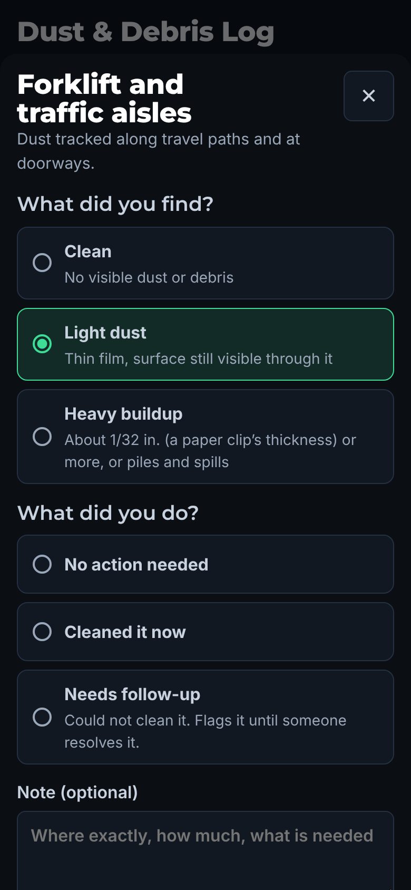
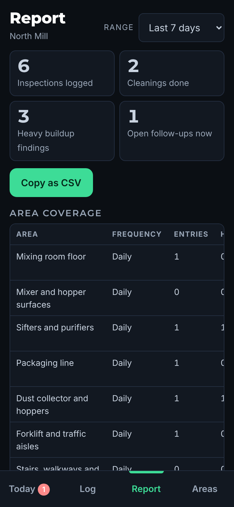

# Mill Dust Log

A phone-friendly housekeeping log for combustible-dust inspections in flour mills and similar food plants. By Caylor Made Technologies.

Live: https://caylor-made-technologies.github.io/grain-mill-dust-log/

<p>
  
  
  
  
</p>

## What it does
- **Plant floor** on the Today tab: one tile per inspection area, colored by **dust left × how overdue** (Clean, on time · Watch · Act now · Not logged), with a legend. Tap a tile to log that area. 3D on capable phones; a flat drawing of the same floor without WebGL, with Reduce Motion, or on phones with ≤ 4 GB memory / ≤ 4 cores. The drawing is keyboard and screen-reader reachable.
- Area checklist with due / overdue status (every shift, daily, weekly, monthly)
- Record what was found, what was done, how it was cleaned, a note, and a photo
- Heavy buildup must be cleaned or flagged; flagged items stay open until resolved
- Entries can't be edited after saving (audit-friendly)
- Report with coverage by area and CSV copy for spreadsheets
- **Installable** (Add to Home Screen) and **works offline**; data stays on the device

## Run it
Open `index.html` through any static server (`python3 -m http.server`), or just open the file (offline mode needs a server). No build step to run the app.

The 3D floor and the shared styles are generated and committed (GitHub Pages publishes the repo as-is). After changing `src3d/` or `caylor-ui/`:
```bash
npm ci
npm run build   # 3d/plant-floor.js (three.js, ~131 KB gzip, loaded after first paint) + ui/
npm test        # saved-data upgrade + zone colors
npm run e2e     # browser checks (Playwright's Chromium); saves docs/screenshots/after-*.png
```
Add `?3d=1` or `?3d=0` to the URL to force the 3D floor or the drawing.

## Files
```
index.html        page shell (strict CSP: no inline scripts or styles, no outside requests)
app.css, app.js   the app
migrate.js        saved-data versions (v1 -> v2), tested
zones.js          plant floor model: zone colors, layout, what stands on each tile
plant.js          the drawing + lazy 3D loader
src3d/            3D source -> 3d/plant-floor.js
caylor-ui/        shared tokens + components (copied; version in caylor-ui/VERSION) -> ui/
sw.js, manifest.webmanifest, icons/, fonts/   offline + install
tests/            unit tests, browser checks, a v1 data fixture
```

## Saved data versions
v1 (`milldust.v1`) is what every release up to November 2026 wrote. v2 (`milldust.v2`) is the same log with a `schema` number and every record checked; the v1 value is left in place as a backup. Entries are never dropped or changed. Photos stay in IndexedDB (`milldust-photos`), unchanged. Restored backups (v1 or v2) go through the same checks.

## Notes
- The starter areas are generic examples. Rename them to match your plant.
- Don't commit real plant data, procedures, or photos to this repo.
- Dust thresholds and cleaning methods should follow your plant's written program and applicable standards (e.g. NFPA 61 / 652), not this app.

## Privacy
- Everything stays on the device that uses it. No accounts, no server, no analytics, and nothing is sent anywhere. Fonts are bundled with the app (Inter and Montserrat, SIL Open Font License, see `fonts/`), so there are no outside requests at all.
- Clearing the browser's site data deletes the log, so copy a backup regularly (Areas tab).
- Only restore backups you made yourself.

## Disclaimer
This app is a record-keeping aid. It does not make a plant compliant with OSHA, NFPA 61, NFPA 652, or any other standard, and it doesn't replace your plant's written combustible dust program, hazard analysis, or supervisor sign-off.
